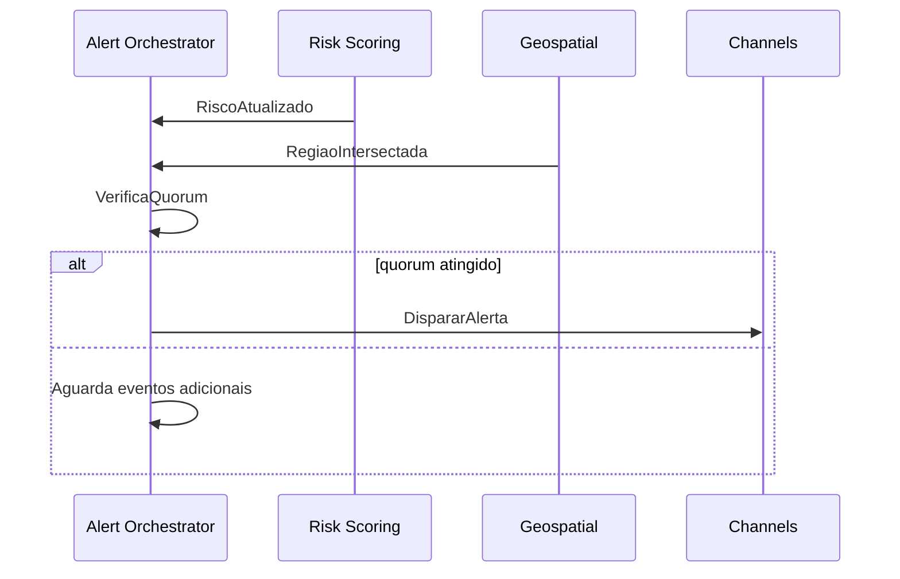

# 5. Orquestração de Alertas

O módulo de **Orquestração de Alertas** é responsável por avaliar riscos atualizados, aplicar regras de disparo, gerenciar escalonamento e quorum, e disparar alertas para os canais apropriados, garantindo auditoria e rastreabilidade de eventos críticos.

## 5.1 Regras de Disparo

As **regras de disparo** definem quando e como um alerta deve ser emitido com base nos dados de risco e eventos recebidos.

**Fontes de entrada:**

- `EventoClimaticoDetectado` (Ingestion Service)
- `RegiaoIntersectada` (Geospatial Service)
- `RiscoAtualizado` (Risk Scoring Service)
- Configurações do **Risk Catalog** e limites por tenant

**Fluxo:**

1. Recebe `RiscoAtualizado` do **Risk Scoring Service**.
2. Avalia contra limites e políticas configuradas:
   - Tipos de risco (incêndio, inundação, terremoto, etc.)
   - Intensidade mínima para disparo
   - Horários ou janelas específicas

3. Registra abertura de **Janela de Alerta** (`JanelaAlertaAberta`) no banco de dados de sagas (PostgreSQL / MongoDB) para rastreabilidade.
4. Caso regras atendidas, dispara comando `DispararAlerta` para o **Channels Service**.

**Exemplo de lógica simplificada:**

```csharp
if (riskScore >= threshold && alertWindowOpen)
{
    DispararAlerta();
}
```

---

## 5.2 Escalonamento e Quorum

Para garantir confiabilidade e minimizar falsos positivos, o **Orquestrador de Alertas** implementa:

### 5.2.1 Escalonamento

- Alertas podem ser escalonados em múltiplos níveis:
  - **Nível 1:** Notificação inicial para autoridades locais (SMS / WhatsApp)
  - **Nível 2:** Ativação de sirenes IoT
  - **Nível 3:** Comunicação para dashboards de defesa civil e relatórios agregados

- Escalonamento pode ser configurado por **tipo de risco**, **localização** e **tenant**.

### 5.2.2 Quorum

- Alguns alertas críticos exigem **confirmação de múltiplas fontes** antes do disparo:
  - Ex.: incêndio detectado por **sensor + satélite** ou **sensor + ML model**

- Implementação:
  - Contabiliza eventos recebidos (`EventoClimaticoDetectado`, `RegiaoIntersectada`)
  - Aguarda `quorum` mínimo antes de emitir `DispararAlerta`
  - Evita disparos duplicados ou falsos positivos

**Fluxo resumido do quorum:**



---

## 5.3 Integração com Outros Serviços

| Serviço                     | Papel na Orquestração                                                                  |
| --------------------------- | -------------------------------------------------------------------------------------- |
| **Ingestion Service**       | Fornece eventos normalizados (`EventoClimaticoDetectado`)                              |
| **Geospatial Service**      | Define regiões afetadas (`RegiaoIntersectada`)                                         |
| **Risk Scoring Service**    | Calcula risco atualizado (`RiscoAtualizado`)                                           |
| **Channels Service**        | Recebe comando `DispararAlerta` e envia notificações (SMS / Push / WhatsApp / Sirenes) |
| **Compliance / Audit**      | Armazena eventos de alerta (`AlertaDisparado`) para auditoria                          |
| **Reporting / Read Models** | Consolida alertas e métricas para dashboards e KPIs                                    |

---

## 5.4 Eventos e Comandos Relevantes

**Comandos:**

- `DispararAlerta` → AO → Channels
- `ConfirmarRecebimentoAlerta` → Channels → AO

**Eventos:**

- `JanelaAlertaAberta` → inicia contagem do tempo de alerta
- `AlertaDisparado` → registrado para auditoria
- `AlertaEntregue` / `AlertaConfirmado` → tracking e métricas de sucesso

---

## 5.5 Estado da implementação (verificado em 2026-10-29)

As seções anteriores descrevem o desenho. Esta descreve o que o código em `services/alert-orchestrator` faz hoje.

**API.** Base `/api/v1/alert-orchestrator`, somente leitura, papel `AlertOrchestrator.Read` (ADR-0002), contrato comum de `docs/compliance/services-validation.md` §4.2:

- `GET /alert-windows/{id}`: uma janela de alerta.
- `GET /alert-windows?region=&status=&page=&pageSize=`: janelas filtradas por região e/ou status (ao menos um dos dois), da mais recente para a mais antiga, só dos tenants da identidade.

As rotas antigas `/api/alert-windows/*` estão depreciadas até 2027-01-23 (ADR-0007).

**Entrada.**

| Tópico | Evento | Tratamento |
|---|---|---|
| `risk-updated` | `RiskUpdatedEvent { EventId, Region, RiskType, RiskScore, TenantId, Timestamp, Metadata }` | confere no tenants-billing se o tenant está ativo, compara o score com o limiar do tipo de risco e abre ou alimenta a janela de alerta da região |
| `region-intersected` | `RegionIntersectedEvent { EventId, Region, IntersectingRegion, RiskType, Severity, Timestamp }` | conta como sinal na janela aberta da região |

Cada evento é processado uma vez, com a reserva atômica `alert-orchestrator:idempotency:v2:{eventId}` no Redis. O consumidor segue o ADR-0003, com DLQ em `alert-orchestrator-dead-letter`.

**Regras.** Os limiares, a duração da janela, o quorum (mínimo de sinais, fontes distintas, exigência de sensor e de satélite) e os intervalos de escalonamento são fixos no código, por tipo de risco (`InMemoryConfigurationPort`: flood, wildfire, earthquake, landslide, storm, heatwave e um padrão). Ainda não vêm do risk-catalog nem variam por tenant. O cooldown por `(região, tipo de risco, tenant)` fica no Redis.

**Workers.** `AlertEscalationWorker` sobe o nível das janelas disparadas e ainda não confirmadas, conforme o tempo desde o disparo, e republica o `TriggerAlertCommand` com o novo nível; `AlertWindowExpirationWorker` expira as janelas vencidas.

**Saída.**

| Tópico | Conteúdo |
|---|---|
| `alert-orchestrator-events` | `AlertWindowOpened`, `AlertTriggered`, `AlertConfirmed`, `AlertEscalated`, `AlertClosed`, `AlertWindowExpired` |
| `alert-commands` | `TriggerAlertCommand` (disparo e cada escalonamento) |

**Persistência.** PostgreSQL `alert_orchestrator` (`alert_windows`, `alert_signals`; migrations EF Core, seção do `2-schema.sql`) e Redis (idempotência e cooldown). Com `Database:UsePostgreSql` / `Cache:UseRedis` desligados, os repositórios ficam em memória.

**Lacunas de integração (X-24).** Nenhum serviço publica em `risk-updated`; o risk-evaluation publica `RiskEvaluatedEvent` em `risk-events`. `region-intersected` depende do geospatial, que não recebe `sensor-event-detected` de ninguém. `alert-orchestrator-events` e `alert-commands` não têm consumidor: o channels lê `notification-events`. Por isso, no ambiente atual, nenhum alerta chega a ser disparado de ponta a ponta.
